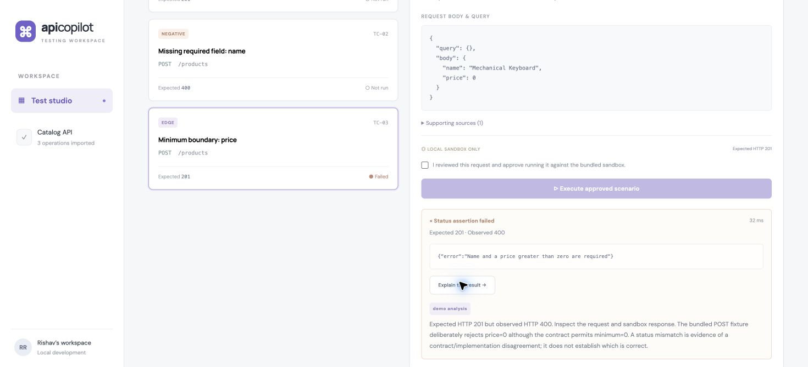

# API Testing Copilot

Generate API test scenarios from an OpenAPI contract, inspect their evidence, approve a request, and see the observed HTTP result. Built with **Java 21, Spring Boot, Spring AI, PostgreSQL/pgvector, and React**.

The central constraint: a model can suggest a test, but application code decides whether the suggestion is valid and what it may execute.

## Run the working demo

Requirements: JDK 21 or newer; Node 20.19+ or 22.12+; internet for the first dependency download. Maven is included through the Apache Maven wrapper. The default demo needs no database, Docker, or provider key.

Terminal 1, from the repository root:

```sh
./mvnw spring-boot:run
```

Terminal 2:

```sh
cd frontend
npm ci
npm run dev
```

Open [the local app](http://127.0.0.1:5173). Load the sample API, import it, select `POST /products`, and generate scenarios. Select the minimum-price case, review the request body, check approval, and execute. Its **expected 201 / actual 400** result reveals an intentional sandbox defect: the contract permits price zero, while the fixture rejects it. Click **Explain this result** for a diagnosis. Try the positive and missing-field cases too.

The sandbox is a disposable fixture: product 1 exists, other IDs return 404, and POST returns a response without storing a product. It is not a commerce backend.

## Import and edit requests

Drop a `.json`, `.yaml` or `.yml` specification onto the import area, choose a file, or paste its contents. Files are read locally into the editor before you click **Import contract**. The same 60,000-character contract limit applies; malformed JSON/YAML reports a line and column when available.

After generation, select **Edit request** to change the body, documented query parameters or expected response status. The form editor preserves JSON value types; JSON view supports nested, array and scalar bodies. **Reset edits** restores the last saved request and **Cancel** discards the draft. Method, path and source references remain fixed to the generated scenario. The backend applies the same scenario validation to saved edits as to generated plans; deliberately invalid business inputs remain possible for negative tests.

Each saved edit increments that scenario's revision. Execution requires the exact reviewed revision and explicit approval; outdated edits or execution requests receive HTTP 409. The UI clears approval after editing and labels previous results with their original revision. Executions retain the request snapshot that actually ran. Generated titles, categories and rationale remain contextual suggestions after an edit, not a new assessment of the edited request. Revisions and execution snapshots are session-only until persistent history is implemented.



## Demo and AI modes

| Behaviour | Demo (default) | AI (`ai` profile) |
| --- | --- | --- |
| Generation | Deterministic schema-derived cases | Spring AI `ChatClient` and typed `Draft` conversion |
| Retrieval | Exact lookup within imported endpoint | OpenAI embeddings, pgvector cosine search, HNSW index |
| Evidence | Endpoint contract and documentation | Contract anchor plus top 4 endpoint-filtered semantic matches |
| Execution | Approved scenario sent directly to sandbox | Model invokes a zero-argument tool bound to the approved scenario |
| Analysis | Deterministic explanation | Model explanation using the recorded result, with no tools |
| Storage | Session memory | Session memory for workflows, persistent vectors in PostgreSQL |

Both modes enforce the same scenario validation, explicit execution approval, fixed sandbox target, method/path allowlist, no redirects, request timeout, response size limit, and session capacity limits. Source citations are checked against the retrieved context. A citation does **not** prove that an assertion is correct.

## Enable AI mode

Docker with Compose is needed for the supplied database setup. Stop an existing backend before restarting it in AI mode.

```sh
docker compose up -d --wait
# Set OPENAI_API_KEY securely in this terminal's environment (never commit it).
export OPENAI_MODEL=gpt-4o-mini
./mvnw spring-boot:run -Dspring-boot.run.profiles=ai
```

The model is configurable; the default is a compatible baseline rather than a claim about the latest model. Embeddings use `text-embedding-3-small` with 1536 dimensions. Changing embedding models requires a matching dimension/schema and reindexing. Database overrides are in [.env.example](.env.example); Spring Boot reads **environment variables**, not that file automatically. Compose reads `.env` for its password override. Keep the values consistent.

AI mode sends imported contract/documentation text and observed sandbox responses to the configured provider and may incur usage charges. Use synthetic project data for the demo. There is no silent fallback from AI mode to demo mode.

**Verification status:** the demo, frontend build, fake-provider structured-output/tool protocol, and real PostgreSQL/pgvector integration have been checked locally. Database tests cover vector dimensions, HNSW index creation, cosine ranking, persisted rows and specification/operation filtering using synthetic embeddings. Live provider verification is incomplete: the embedding API rejected the smoke check because API credit was exhausted. Model quality and production performance have not been benchmarked.

For a private local configuration, create `.env.ai.properties` (ignored by Git):

```properties
OPENAI_API_KEY=your-key-here
DATABASE_URL=jdbc:postgresql://127.0.0.1:5432/copilot
DATABASE_USER=copilot
DATABASE_PASSWORD=copilot-local
```

Start with `./scripts/run-ai.sh`. The script explicitly loads this file without putting the key in command arguments. Ensure the database URL matches your setup; the dedicated database on this development machine uses port **55432**, while Compose uses **5432**.

To reproduce a live smoke check after configuring API billing, run `python3 scripts/smoke-ai.py` while AI mode is running. It imports the synthetic sample, retrieves evidence, generates a validated plan, checks approval enforcement, invokes the approved execution tool and requests analysis. It incurs provider usage and writes its result under the ignored `.tools/` directory. Credit/quota failures produce a fixed, actionable error without exposing provider payloads.

## Verify

```sh
./mvnw verify
cd frontend
npm ci
npm test
npm run build
```

The default backend suite covers local reference resolution, prohibited remote references, recursive schemas, scenario validation, source isolation, actual sandbox HTTP execution, approval enforcement, provider error sanitization, typed model responses, and tool invocation with synthetic provider responses. HTTP tests bind random localhost ports. CI runs the suite on JDK 21, builds React on Node 24 and runs a database integration job against pgvector.

For database verification, start PostgreSQL/pgvector, then run:

```sh
./mvnw -B -ntp -Pintegration verify
# Dedicated local development database:
TEST_DATABASE_URL=jdbc:postgresql://127.0.0.1:55432/copilot ./mvnw -B -ntp -Pintegration verify
```

Optional test overrides: `TEST_DATABASE_USER` and `TEST_DATABASE_PASSWORD`. Database tests create a unique schema and remove it after the run; application tables are not truncated. They use synthetic 1536-dimensional vectors and make no provider calls.

## API

All JSON endpoints are under `/api`. Error responses use Spring `ProblemDetail`.

| Method | Path | Purpose |
| --- | --- | --- |
| GET | `/api/info` | Mode, target and storage information |
| POST | `/api/specifications` | Import `{name, content, documentation}` |
| GET | `/api/specifications` | List imports in the current session |
| POST | `/api/plans` | Generate using `{specificationId, endpointKey}` |
| GET | `/api/plans/{id}` | Reload the current plan and its `scenarioRevisions` |
| PUT | `/api/plans/{id}/scenarios/{index}` | Save `{expectedRevision, query, body, expectedStatus}` |
| POST | `/api/executions` | Execute `{planId, scenarioIndex, expectedRevision, approved: true}` |
| POST | `/api/executions/{id}/analysis` | Explain a recorded result |
| GET | `/actuator/health` | Backend health |

`expectedRevision` is required for both editing and execution; take it from `plan.scenarioRevisions[scenarioIndex]`. Clients using the older execution payload must supply this field. A successful edit returns the updated plan. Execution responses include `scenarioRevision` and `requestSnapshot`; existing analysis uses the recorded execution even if the plan is edited later.

## Technical documentation

- [Architecture and data flow](docs/ARCHITECTURE.md) — component boundaries and design tradeoffs.
- [Evaluation protocol](docs/EVALUATION.md) — what is measured, what is not, and how to collect real model evidence.
- [Architecture decisions](docs/decisions/) — why the project is structured this way.

## Scope and limitations

This is a **single-user localhost application**, not an authenticated production service. It supports a useful subset of OpenAPI 3 JSON/YAML: ordinary operations, local nonrecursive references, parameters, JSON request schemas and explicit numeric response statuses. It does not implement complete OpenAPI/JSON Schema validation, recursive models, reference sibling merging, composed schemas, XML/multipart test generation, auth flows, or wildcard response-status matching. Demo cases are templates and can require manual fixture adjustments for unfamiliar APIs.

Only GET `/products`, GET `/products/{id}`, and POST `/products` may execute, always against the bundled sandbox on the application's own loopback port. Specification `servers` URLs and generated hostnames are never used. The current assertion is **HTTP status equality**; response-schema and business-state assertions are future work.

Imports, plans and execution records reset when the backend restarts. AI vectors persist and need explicit lifecycle/cleanup work before long-running use. Session caps are 20 imports, 100 plans, and 200 executions. A single service lock serializes expensive operations, making capacity checks simple but limiting concurrency. Durable approval workflows, cross-request idempotency, distributed job queues, and comprehensive telemetry are not implemented.

## References

- [Spring AI 1.1 ChatClient](https://docs.spring.io/spring-ai/reference/1.1/api/chatclient.html)
- [Spring AI tool calling](https://docs.spring.io/spring-ai/reference/1.1/api/tools.html)
- [Spring AI pgvector integration](https://docs.spring.io/spring-ai/reference/api/vectordbs/pgvector.html)
- [OpenAI structured output concepts](https://developers.openai.com/api/docs/guides/structured-outputs)

This version uses Spring AI's typed conversion plus application validation. It does not currently enable provider-native strict JSON Schema output.
