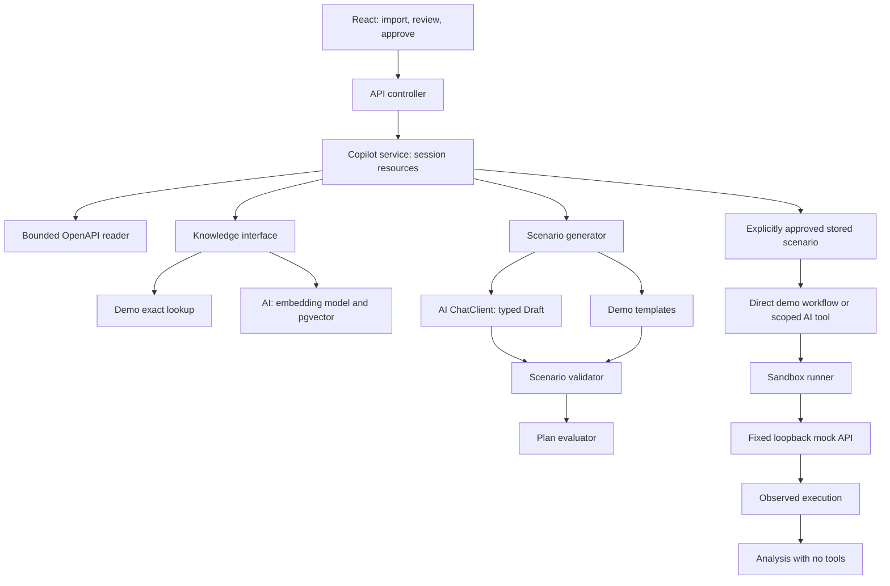

# Architecture

## Generation lifecycle

1. HTTP Bean Validation checks import size and required fields.
2. The reader normalizes the contract without fetching external resources.
3. The service creates a specification ID and indexes its evidence. It publishes the import only after indexing returns successfully.
4. Generation selects an endpoint belonging to that import.
5. Retrieval scopes evidence by specification ID and operation key. AI mode additionally ranks matching vectors.
6. The generator creates a typed draft. It has no execution tools.
7. The validator checks shape and contract/evidence invariants. Invalid drafts are not stored.
8. The evaluator counts categories and citation presence; the plan is saved in memory and returned for review.

## Execution lifecycle

1. The browser displays the generated request and requires explicit approval.
2. The server checks approval again, resolves the stored plan, and checks the scenario index.
3. In AI mode a per-request tool wraps that fixed action. It accepts no model-supplied arguments and can attempt HTTP execution only once.
4. The runner allows only the bundled fixture's method/path combinations. It never uses OpenAPI `servers` values or a user-provided host.
5. An HTTP client sends to `127.0.0.1` on the running application's port. Redirects are disabled, timeout is five seconds, and only the first 8192 response bytes are read.
6. The observed status is compared to the expected status. The execution is stored separately from the suggested plan.
7. Analysis receives a recorded result and no tools. It cannot execute another request.

## Where the data lives

| Data | Demo | AI |
| --- | --- | --- |
| Specification metadata | Concurrent map | Concurrent map |
| Evidence chunks | Concurrent map | pgvector document table |
| Plans | Concurrent map | Concurrent map |
| Executions | Concurrent map | Concurrent map |
| Embeddings | None | PostgreSQL, 1536-dimensional vectors |
| Provider key | Not needed | Environment variable, never returned by the API |

AI vectors currently outlive the session metadata. Imports after restart receive new IDs, so old vectors are not reused. Orphan cleanup, durable metadata and atomic import workflows are future improvements. If a vector-store write partially succeeds and then fails, some orphan vectors may remain; the app does not pretend this is a cross-system transaction.

## Important tradeoffs

**Modular monolith:** one process keeps orchestration understandable. It avoids service-network failure modes while the domain is small. [Decision 1](decisions/0001-modular-monolith.md).

**Manual AI configuration:** only the `ai` profile creates provider/database beans. Default startup cannot accidentally call a paid provider or require a database. Versions are pinned to a compatible Spring Boot 3.5 / Spring AI 1.1 pair.

**Deterministic baseline:** demo cases help establish whether additional LLM complexity produces useful coverage. Exact lookup is labelled honestly rather than described as semantic retrieval.

**Filtered retrieval plus contract anchor:** the explicit operation contract remains in context even if prose ranks above it. Supporting prose is duplicated per operation, which is simple but storage-inefficient for larger documents. A future design should split shared documentation and use metadata references.

**Prompt-based typed conversion:** Spring AI generates formatting instructions and converts output to a record. Provider-native strict JSON Schema is not enabled. Malformed or domain-invalid output fails closed; automatic repair is not attempted.

**Coarse service synchronization:** capacity checks and writes are simple and deterministic, but slow provider calls serialize unrelated requests. A production design should use durable jobs, bounded queues, cancellation, per-resource locking and quotas.

**Limited assertions:** an HTTP 201 response may still have a wrong body or incorrect side effects. This version checks status only. Additional assertion types belong in an explicit model and a deterministic assertion engine.

## Security boundary and remaining gaps

This app binds to loopback and has no login or tenant isolation. Endpoint metadata filtering is not access control. Do not expose the development servers publicly. Contracts, documentation and responses are treated as untrusted text in prompts. The stronger boundary is the absence of execution tools during generation, explicit approval before execution, and application-owned target selection.

The tool guard covers repeated calls within one model invocation. It does not cover duplicate user submissions, retries by clients, crashes between a network side effect and storing its result, or a second process. Durable idempotency would require a unique request key, state transitions, a persisted request hash and careful handling of uncertain network outcomes.

Local input bounds reduce accidental resource use, but this is not a hardened multi-user ingestion service. Production requirements include strict HTTP body limits, full schema validation, authentication, encryption/access policies for documents, provider data policies, outbound network isolation, database lifecycle migrations and audited approvals.
